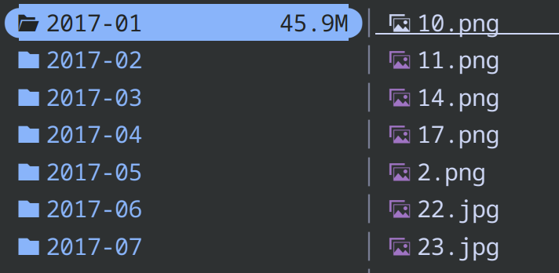
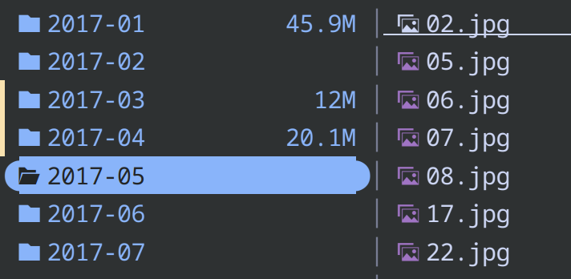

**cal**culate **cum**ulative **size**

ranger-like and -inspired function

```sh
ya pkg add Schroedingersdoraemon/calcumsize

# or manually git clone
mkdir -p ~/.config/yazi/plugins/
cd ~/.config/yazi/plugins/
git clone https://github.com/Schroedingersdoraemon/calcumsize.yazi
```

then `~/.config/yazi/keymap.toml`

```toml
[[mgr]]

prepend_keymap = [

    { on = [ "d", "c" ], run = "plugin calcumsize", desc = "get cumulative size" },

    ... ...

]
```

#### get size of currently highlighted entry



#### or get size of multiple entries


